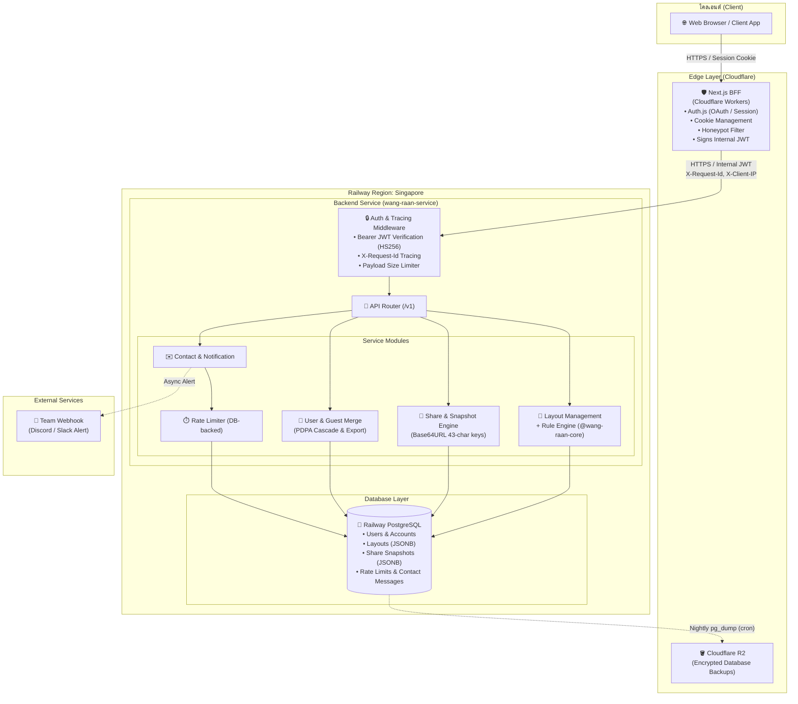
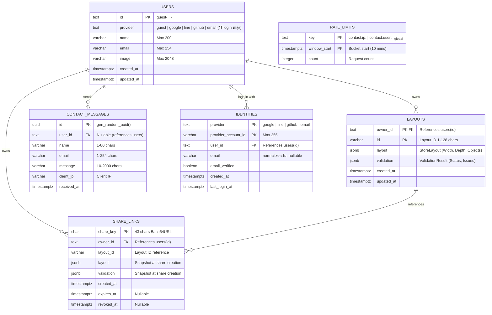
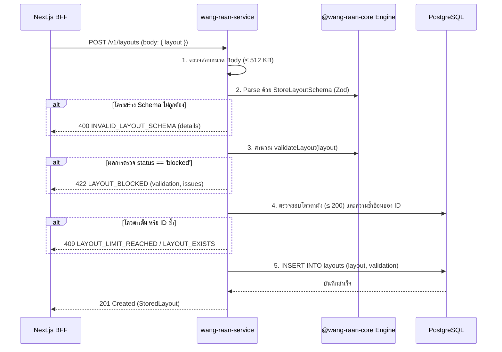

# Technical Architecture Document — wang-raan-service

> **Service:** วางร้าน (Wang-Raan) Backend API  
> **Repository:** `wang-raan-service`  
> **Runtime & Platform:** Node.js ≥ 20 (TypeScript) on Docker / Railway (Singapore)  
> **Database:** PostgreSQL (Railway Singapore) + Cloudflare R2 (Nightly Backup)  
> **Reference Specs:** [`contracts/openapi.yaml`](./contracts/openapi.yaml) (v1.1.0), [`BACKEND_HANDOFF.md`](./BACKEND_HANDOFF.md), [`PRD.md`](./PRD.md)  
> **Version:** 1.1.0  

---

## 1. ภาพรวมสถาปัตยกรรมระบบ (System Overview & Topology)

`wang-raan-service` ทำหน้าที่เป็น Core Business & Persistence Layer สำหรับระบบวางร้าน โดยทำงานอยู่หลัง Next.js BFF (Backend For Frontend) อย่างเบ็ดเสร็จ เบราว์เซอร์ของไคลเอนต์จะไม่สามารถเข้าถึง Service นี้ได้โดยตรง ทุกคำขอจะต้องผ่านการคัดกรอง ยืนยันตัวตน และส่งต่อผ่านเครือข่ายภายในด้วย Internal JWT Token



---

## 2. การเลือกเทคโนโลยีและเหตุผล (Technology Stack Selection)

| ชั้นของระบบ | เทคโนโลยีที่เลือก | เหตุผลในการเลือก |
|---|---|---|
| **Runtime & Language** | **Node.js 20 LTS + TypeScript (Strict)** | รองรับ ESM, Native Web Crypto API (`crypto.getRandomValues`), ประสิทธิภาพสูง และเข้ากันได้กับโค้ดเบสขององค์กร |
| **HTTP Framework** | **Fastify** (แนะนำ) | ประสิทธิภาพสูง (High throughput), มี Schema validation ในตัว, จัดการ Payload size limit ต่อ route ได้สะดวก และรองรับ Structured logging (Pino) โดยกำเนิด |
| **Database & Driver** | **PostgreSQL + `pg` Pool** | ฐานข้อมูลเชิงสัมพันธ์มาตรฐาน มีฟีเจอร์ `jsonb` ที่ทรงพลังและ ACID Transaction ที่สมบูรณ์แบบ |
| **Query Builder / ORM** | **Kysely** หรือ **Drizzle ORM** | Type-safe SQL query builder แบบ zero-overhead ไม่มีปัญหา cold-start หรือ memory footprint สูงเหมือน Prisma เหมาะกับการเก็บ `jsonb` |
| **Migration Runner** | **Kysely Migration CLI** หรือ **node-pg-migrate** | ควบคุม migration ไฟล์เป็น pure SQL/TypeScript ชัดเจน รันอัตโนมัติใน Docker entrypoint |
| **JWT Verification** | **`jose`** | ไลบรารีมาตรฐานสากลสำหรับ Web Cryptography ทำงานเร็ว ปลอดภัย ป้องกัน Timing attacks |
| **Core Rule Engine** | `@bosskantaponguttarawichien-boop/wang-raan-core` | ไลบรารีคำนวณระยะและความปลอดภัยของผังร้าน ใช้ร่วมกันระหว่าง Frontend และ Backend เพื่อ Single Source of Truth |
| **Schema Validation** | **Zod (`^3.25`)** | Type inference และ runtime schema validation ตามข้อกำหนด peer dependency ของ core package |

---

## 3. สถาปัตยกรรมความปลอดภัยและการยืนยันตัวตน (Security & Authentication)

### 3.1 การตรวจสอบ Internal JWT (Zero-Trust Pipeline)
ทุกคำขอที่เข้ามายัง Backend (ยกเว้น `GET /health`) ต้องผ่าน Middleware ตรวจสอบ Token ดังนี้:

1. ดึง Token จาก Header `Authorization: Bearer <token>`
2. ถอดรหัสและตรวจสอบลายเซ็นด้วยอัลกอริทึม `HS256` ผ่าน `INTERNAL_TOKEN_SECRET`
3. ตรวจสอบ Claim บังคับ:
   - `iss === "wang-raan-bff"`
   - `aud === "wang-raan-backend"`
   - `exp`: หมดอายุภายใน 300 วินาที โดยรองรับ Clock tolerance ±5 วินาที
4. ตรวจสอบ `sub`:
   - รูปแบบที่ยอมรับ: `guest-<uuid>` หรือ `<provider>-<providerAccountId>` (เช่น `google-1234`)
   - หาก `sub === "anonymous"`: อนุญาตเฉพาะ Route ที่กำหนด Flag `x-allow-anonymous` (`GET /v1/public/shares/:shareKey` และ `POST /v1/contact-messages`) หากพบใน Route อื่นต้องปฏิเสธทันทีด้วย `401 UNAUTHORIZED`
5. **ข้อห้ามเด็ดขาด:** ห้ามอ่าน User ID จาก Body, Query หรือ Parameter อื่น ให้ผูก Context ของผู้ใช้กับ `sub` จาก Token เสมอ

```ts
// src/middleware/auth.ts
import { jwtVerify } from "jose";

const secretKey = new TextEncoder().encode(process.env.INTERNAL_TOKEN_SECRET);

export interface RequestUserContext {
  userId: string;
  isAnonymous: boolean;
}

export async function verifyInternalToken(authHeader: string | undefined): Promise<RequestUserContext | null> {
  if (!authHeader || !authHeader.startsWith("Bearer ")) return null;
  const token = authHeader.slice(7);
  try {
    const { payload } = await jwtVerify(token, secretKey, {
      algorithms: ["HS256"],
      issuer: "wang-raan-bff",
      audience: "wang-raan-backend",
      clockTolerance: 5,
    });
    if (typeof payload.sub !== "string") return null;
    return {
      userId: payload.sub,
      isAnonymous: payload.sub === "anonymous",
    };
  } catch {
    return null;
  }
}
```

### 3.2 การแยกข้อมูลผู้ใช้ (Multi-Tenant Isolation)
- ทุก Query ที่เข้าถึงผังร้าน (`layouts`) หรือลิงก์แชร์ส่วนตัว (`share_links`) ต้องมีเงื่อนไข `WHERE owner_id = :userId` ในระดับ SQL เสมอ
- หากผู้ใช้พยายามเข้าถึงทรัพยากรที่ไม่มีอยู่จริง หรือเป็นของผู้อื่น ระบบจะส่งกลับ **`404 NOT_FOUND`** เสมอ (ห้ามส่ง `403 FORBIDDEN` เพื่อป้องกันการสุ่มเจาะ ID)

### 3.3 การปกป้องข้อมูลใน Public Share Link
- Endpoint `GET /v1/public/shares/{shareKey}` คืนเฉพาะข้อมูล `layout`, `validation`, `createdAt`, `expiresAt`
- ข้อมูล `owner_id`, ข้อมูลส่วนตัวของผู้สร้าง หรือ Token อ้างอิง จะถูกตัดทิ้ง (Strip) ตั้งแต่ระดับ SQL SELECT

---

## 4. โครงสร้างฐานข้อมูล (Database Schema & Persistence)

ผังร้าน (`StoreLayout`) และผลตรวจ (`ValidationResult`) เป็นข้อมูลที่มีโครงสร้างลำดับชั้น (Hierarchical Object Tree) และถูกอ่าน/เขียนทั้งฉบับพร้อมกันเสมอ จึงถูกจัดเก็บเป็นคอลัมน์ `jsonb` เพื่อความรวดเร็วและยืดหยุ่น



### รายละเอียด DDL และ Indexing

```sql
-- 1. Users Table
CREATE TABLE users (
  id          text PRIMARY KEY,
  provider    text NOT NULL CHECK (provider IN ('guest','google','line','github','email')),
  name        varchar(200),
  email       varchar(254),
  image       varchar(2048),
  created_at  timestamptz NOT NULL DEFAULT now(),
  updated_at  timestamptz NOT NULL DEFAULT now()
);

-- 2. Layouts Table (Composite Primary Key: owner_id, id)
CREATE TABLE layouts (
  owner_id    text NOT NULL REFERENCES users(id) ON DELETE CASCADE,
  id          varchar(128) NOT NULL,
  layout      jsonb NOT NULL,
  validation  jsonb NOT NULL,
  created_at  timestamptz NOT NULL DEFAULT now(),
  updated_at  timestamptz NOT NULL DEFAULT now(),
  PRIMARY KEY (owner_id, id)
);
CREATE INDEX layouts_owner_updated ON layouts (owner_id, updated_at DESC);

-- 3. Share Links Table
CREATE TABLE share_links (
  share_key   char(43) PRIMARY KEY,
  owner_id    text NOT NULL REFERENCES users(id) ON DELETE CASCADE,
  layout_id   varchar(128) NOT NULL,
  layout      jsonb NOT NULL,
  validation  jsonb NOT NULL,
  created_at  timestamptz NOT NULL DEFAULT now(),
  expires_at  timestamptz,
  revoked_at  timestamptz
);
CREATE INDEX share_links_owner_layout ON share_links (owner_id, layout_id, created_at DESC);

-- 4. Contact Messages Table
CREATE TABLE contact_messages (
  id          uuid PRIMARY KEY DEFAULT gen_random_uuid(),
  user_id     text REFERENCES users(id) ON DELETE CASCADE,
  name        varchar(80)   NOT NULL,
  email       varchar(254)  NOT NULL,
  message     varchar(2000) NOT NULL,
  client_ip   varchar(64),
  received_at timestamptz NOT NULL DEFAULT now()
);

-- 5. Rate Limits Table
CREATE TABLE rate_limits (
  key          text NOT NULL,
  window_start timestamptz NOT NULL,
  count        integer NOT NULL DEFAULT 0,
  PRIMARY KEY (key, window_start)
);

-- 6. Identities Table (migration 002) — วิธี login ที่ผูกกับบัญชี, Backend หาบัญชีจาก (provider, provider_account_id)
--    email เก็บแบบ trim + ตัวพิมพ์เล็ก ใช้ผูกบัญชีเฉพาะแถวที่ email_verified; Guest ไม่มี identity
--    backfill ผู้ใช้เดิม <provider>-<id> คนละแถว (email_verified = false, ไม่รวมบัญชีที่อีเมลซ้ำ)
CREATE TABLE identities (
  provider            text NOT NULL CHECK (provider IN ('google','line','github','email')),
  provider_account_id varchar(255) NOT NULL CHECK (provider_account_id <> ''),
  user_id             text NOT NULL REFERENCES users(id) ON DELETE CASCADE,
  email               varchar(254) CHECK (email = lower(btrim(email)) AND email <> ''),
  email_verified      boolean NOT NULL DEFAULT false,
  created_at          timestamptz NOT NULL DEFAULT now(),
  last_login_at       timestamptz,
  PRIMARY KEY (provider, provider_account_id)
);
CREATE INDEX identities_user ON identities (user_id);
CREATE INDEX identities_verified_email ON identities (email) WHERE email_verified;
```

### การทำ Transaction พิเศษ (Atomic Workflows)

1. **การลบผังร้าน (`DELETE /v1/layouts/{layoutId}`):**
   - ลบแถวใน `layouts`
   - ปรับสถานะ `UPDATE share_links SET revoked_at = now() WHERE owner_id = :userId AND layout_id = :layoutId AND revoked_at IS NULL`
   - ทำงานใน Transaction เดียวกัน
2. **การโอนย้ายผัง Guest (`POST /v1/me/merge-guest`):**
   - ตรวจสอบ ID ผังของ Guest เทียบกับผังของ User ปัจจุบัน
   - หากมี ID ชนกัน ทำการ Generate ID ใหม่ (เช่น `<id>-guest-copy`) และบันทึกประวัติ `renamed: [{ from, to }]`
   - `UPDATE layouts SET owner_id = :currentUserId, id = :newId WHERE owner_id = :guestId`
   - `UPDATE share_links SET owner_id = :currentUserId, layout_id = :newId WHERE owner_id = :guestId`
   - `DELETE FROM users WHERE id = :guestId`
   - ทุกขั้นตอนทำงานภายใต้ `BEGIN ... COMMIT`

---

## 5. กระบวนการตรวจสอบผังร้าน (Floor Layout Validation Engine)

ก่อนบันทึกผังร้านลงฐานข้อมูล Backend จะบังคับตรวจสอบตามขั้นตอน:



- **สถานะ `blocked`:** บ่งชี้ว่าผังร้านมีปัญหาขั้นวิกฤต เช่น ไม่มีทางเข้าออก หรือมีการทับซ้อนของโครงสร้างหลัก จะ**ไม่ถูกบันทึก**ลงฐานข้อมูลเด็ดขาด
- **สถานะ `warning` หรือ `ready`:** อนุญาตให้บันทึกลงฐานข้อมูลและสร้างลิงก์แชร์ได้ตามปกติ

---

## 6. กลไกการจำกัดอัตราการเรียก (Rate Limiting Engine)

สำหรับ Endpoint ที่มีความเสี่ยงต่อการถูกแสวงหาประโยชน์ เช่น `POST /v1/contact-messages` ระบบใช้ Fixed Window Algorithm บนฐานข้อมูล:

1. กำหนด Window ขนาด 10 นาที: `window_start = date_trunc('minute', now()) - ((extract(minute from now())::int % 10) * interval '1 minute')`
2. ตรวจสอบ 3 มิติพร้อมกัน:
   - **IP Window:** Key `contact:ip:<X-Client-IP>` (Limit = 5)
   - **User Window:** Key `contact:user:<sub-id>` (Limit = 5, กรณีไม่ใช่ anonymous)
   - **Global Window:** Key `contact:global` (Limit = 50)
3. หากค่าใดเกินขีดจำกัด คำนวณเวลาที่เหลือจนจบรอบ Window และส่งกลับ:
   - Status: `429 Too Many Requests`
   - Header: `Retry-After: <seconds>`
   - Response Body: `{ error: { code: "RATE_LIMITED", retryAfter: <seconds> } }`
4. มี Background Worker ลบแถว `rate_limits` ที่เก่ากว่า 1 ชั่วโมงออกอัตโนมัติ

---

## 7. โครงสร้างซอร์สโค้ด (Directory & Module Structure)

```
wang-raan-service/
├── .github/
│   └── workflows/
│       └── ci.yml               # Lint, Build, Contract Test
├── harness/                     # ← Agent Harness Ecosystem
│   ├── init.sh                  # Environment initialization & boundary check
│   ├── feature_list.json        # Master task tracking (Single source of truth)
│   ├── feature_list.archive.json # Archive records
│   ├── progress.md              # Worklog บันทึกความคืบหน้าของแต่ละ session
│   ├── session-handoff.md       # เอกสารส่งต่องานระหว่างเซสชัน
│   └── sprint-1.md              # แผนงาน Sprint 1
├── scripts/                     # ← เครื่องมือสนับสนุน Harness
│   ├── harness_state.py         # ตัวโหลด state และ merge archive
│   └── validate_harness.py      # ตัวตรวจจับ Schema, Broken/Cyclic Deps
├── contracts/                   # ← สัญญา API ระหว่าง BFF กับ Backend
│   ├── openapi.yaml             # OpenAPI Spec 3.1.0 (v1.1.0)
│   └── redocly.yaml             # Redocly lint configuration
├── docker-compose.yml           # Local dev (Service + Postgres)
├── Dockerfile                   # Multi-stage production build
├── package.json
├── tsconfig.json
├── Makefile                     # รวมคำสั่งลัดประจำโปรเจกต์
├── PRD.md                       # Product Requirements Document
├── architecture.md              # Technical Architecture Document (ไฟล์นี้)
├── BACKEND_HANDOFF.md           # Backend Interface Guidelines
├── SKILL.md                     # Core Developer Rules & Checklist
├── AGENTS.md                    # คู่มือปฏิบัติการของ Agent
├── README.md                    # ภาพรวมโปรเจกต์และคู่มือเริ่มต้น
├── .npmrc                       # GitHub Packages config for @bosskantaponguttarawichien-boop
├── src/
│   ├── config/
│   │   └── env.ts               # Env parsing & validation with Zod
│   ├── db/
│   │   ├── client.ts            # Kysely / pg connection pool
│   │   ├── migrations/          # Migration SQL scripts
│   │   └── migrator.ts          # Migration runner on startup
│   ├── middleware/
│   │   ├── auth.ts              # Bearer Internal JWT parser
│   │   ├── request-id.ts        # X-Request-Id injector
│   │   ├── error-handler.ts     # Global uniform error serializer
│   │   └── payload-limiter.ts   # Route-level body size guards
│   ├── modules/
│   │   ├── health/              # GET /health
│   │   ├── layouts/             # Layouts CRUD, Validation, Quota
│   │   ├── shares/              # Share links, Snapshots, Public Viewer
│   │   ├── users/               # Me, Upsert, PDPA export/delete, Merge Guest
│   │   └── contact/             # Contact messages, Rate limit, Alerts
│   ├── services/
│   │   ├── validator.ts         # Wrapper for @wang-raan-core
│   │   ├── notifier.ts          # Discord/Slack/Email dispatcher
│   │   └── share-generator.ts   # 43-char cryptographically secure keys
│   ├── types/
│   │   └── contracts.ts         # TypeScript types matching OpenAPI
│   └── app.ts                   # Fastify app bootstrap
```

---

## 8. การสำรองข้อมูลและการกู้คืน (Disaster Recovery & Backup)

- **Backup Source:** Railway PostgreSQL (Singapore)
- **Backup Destination:** Cloudflare R2 (Object Storage) ข้าม Region
- **วิธีการ:** รัน Cron Job ทุกคืน ทำ `pg_dump` และบีบอัดด้วย gzip แล้วอัปโหลดผ่าน S3-compatible API ไปยัง R2 Bucket
- **Retention Policy:** เก็บรายวันย้อนหลัง 30 วัน, รายสัปดาห์ 12 สัปดาห์
- **Disaster Recovery Drill:** จัดให้มีการซ้อมกู้คืนข้อมูล (Restore Test) เป็นระยะ โดยบันทึกเวลา RTO (Recovery Time Objective < 30 นาที) และ RPO (Recovery Point Objective < 24 ชั่วโมง)
